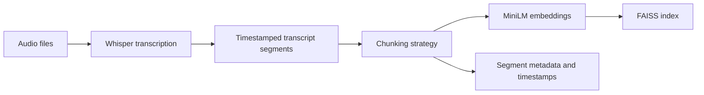
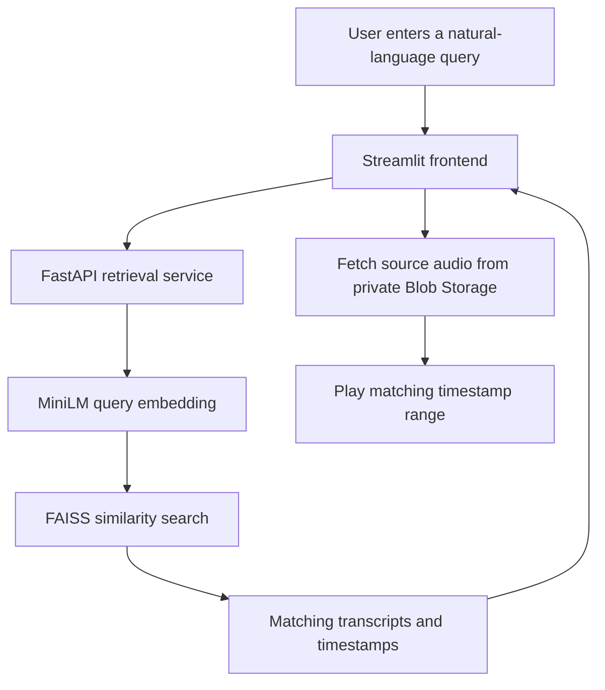

# Semantic Audio Search Engine

A semantic search application that finds relevant moments in audio recordings from natural-language queries and lets users play the matching audio at its original timestamps.

Rather than generating an answer, this project focuses on **retrieving and navigating to source evidence**. It combines speech transcription, sentence embeddings, FAISS vector search, a FastAPI retrieval service, and a Streamlit interface.

## Features

- **Natural-language audio search:** Find spoken content without matching the exact words in a transcript.
- **Timestamp-aware results:** View relevant transcript segments with start and end times and play the corresponding portion of the recording.
- **Vector similarity retrieval:** Search MiniLM embeddings using a FAISS index with cosine similarity (normalized vectors and inner product).
- **Retrieval evaluation:** Compare chunking strategies using Hit Rate@K and Mean Reciprocal Rank (MRR).
- **Containerized services:** Run the FastAPI backend and Streamlit frontend with Docker and Docker Compose.
- **Cloud deployment:** Host both services on Azure Container Apps, with private audio files in Azure Blob Storage.

## Architecture

The project has two main workflows: offline indexing and online search.

### Offline indexing



### Online search and playback



The query is embedded and compared against the precomputed FAISS index. FastAPI returns ranked transcript matches with timestamps; Streamlit fetches the source WAV file and plays the relevant time range.

### Cloud deployment (at a glance)

The two Docker images are stored in **Azure Container Registry** and deployed as separate **Azure Container Apps** within the same environment. **Streamlit** has public HTTPS ingress, while **FastAPI** has internal ingress only. Audio recordings live in a private **Azure Blob Storage** container; Streamlit accesses them using its managed identity and the **Storage Blob Data Reader** role.

## Technology stack

| Layer | Technologies |
| --- | --- |
| Speech transcription | Whisper large-v3-turbo (offline preprocessing) |
| Embeddings | SentenceTransformers, `all-MiniLM-L6-v2` (384 dimensions) |
| Vector search | FAISS (`IndexFlatIP` / ID mapping, normalized vectors) |
| Backend | Python, FastAPI |
| Frontend | Streamlit, Pydub, FFmpeg |
| Local deployment | Docker, Docker Compose |
| Cloud deployment | Azure Container Apps, Azure Container Registry |
| Audio storage and access | Azure Blob Storage, managed identity, Azure RBAC |

Whisper transcription and index creation are performed **offline**; the deployed API performs query embedding and retrieval rather than transcribing recordings on each request.

## Retrieval evaluation

Initial experiments compared timestamped segment-based chunking against fixed-size word chunks.

| Chunking approach | Hit Rate@K | MRR |
| --- | ---: | ---: |
| Timestamped segments | 55.3% | 0.36 |
| Fixed 20-word chunks | 43.75% | 0.26 |

These are results from an initial evaluation, not a claim of production-scale accuracy. Retrieval quality depends on the dataset, queries, relevance labels, and choice of K. Future work includes larger evaluations and longer recordings.

## Repository layout

```text
semantic-video-search/
├── app/
│   ├── streamlit_app.py        # Search UI and audio playback
│   └── audio_storage.py        # Azure Blob Storage access
├── src/
│   ├── api/main.py             # FastAPI endpoints
│   └── retrieval/              # Embedding, indexing and retrieval logic
├── artifacts/
│   ├── index.faiss             # Generated vector index
│   └── metadata.json           # Segment metadata
├── data/audio/                 # Local audio dataset (if available)
├── environment/                # Local environment configuration
├── Dockerfile.api
├── Dockerfile.app
├── compose.yaml
├── requirements-api.txt
└── requirements-app.txt
```

## Run locally

### Prerequisites

- Docker Engine or Docker Desktop with Docker Compose
- Access to the project's FAISS index and metadata artifacts
- Audio files or correctly configured Azure Blob Storage access, depending on your local configuration

1. Clone the repository:

   ```bash
   git clone <YOUR_REPOSITORY_URL>
   cd semantic-video-search
   ```

2. Configure the environment files referenced by `compose.yaml`. Set the FastAPI index/metadata paths and the Streamlit API URL as appropriate for your local setup. **Do not commit credentials or real `.env` files.**

3. Build and start both services:

   ```bash
   docker compose up --build
   ```

4. Open the Streamlit interface at <http://localhost:8501>. The API is available at <http://localhost:8000> if its port is published by your Compose configuration.

> The exact environment variables, volume mounts, and audio source should match the checked-in `compose.yaml`. If the repository does not include the audio dataset or generated index, obtain or generate those artifacts before starting the services.

## Azure deployment overview

The cloud deployment was performed using these components:

1. **Resource group:** Group the resources for the project.
2. **Blob Storage:** Upload WAV recordings to a private `audio` container.
3. **Azure Container Registry:** Store versioned FastAPI and Streamlit Docker images.
4. **Container Apps environment:** Host both application services in a shared environment.
5. **Container Apps:** Deploy FastAPI with internal ingress (port 8000) and Streamlit with external ingress (port 8501).
6. **Identity and authorization:** Configure registry image-pull permissions and grant Streamlit's managed identity read access to audio blobs.
7. **Configuration and scaling:** Supply runtime environment variables, set resource limits, and configure replicas.

For security, the frontend connects to the backend using the backend's internal URL, while Blob access uses managed identity rather than embedded account keys.

**Cost note:** Scaling Container Apps to zero reduces idle compute usage but does not eliminate charges from services such as Container Registry, Blob Storage, and logging. Remove unused resources when no longer needed.

## Semantic search vs. RAG

This project is a **semantic multimedia retrieval system**, not a retrieval-augmented generation (RAG) chatbot. It retrieves matching transcript passages and plays their original audio, rather than passing passages to a large language model to synthesize an answer. An optional future extension could add timestamp-cited question answering on top of the existing retrieval pipeline.

## Future improvements

- Evaluate retrieval on longer recordings and a larger labeled query set.
- Extend timestamp-based navigation from audio to video.
- Add automated tests and GitHub Actions CI/CD for versioned container builds and controlled Azure deployments.
- Add deployment health checks, monitoring, and latency measurements.
- Explore optional LLM-generated answers with citations to source timestamps.

## Project status

**Implemented:** Offline transcription/indexing, semantic retrieval, timestamp-aware audio playback, Docker-based local development, and Azure deployment.

**Planned:** CI/CD automation, larger-scale evaluation, video support, and production-style monitoring.
